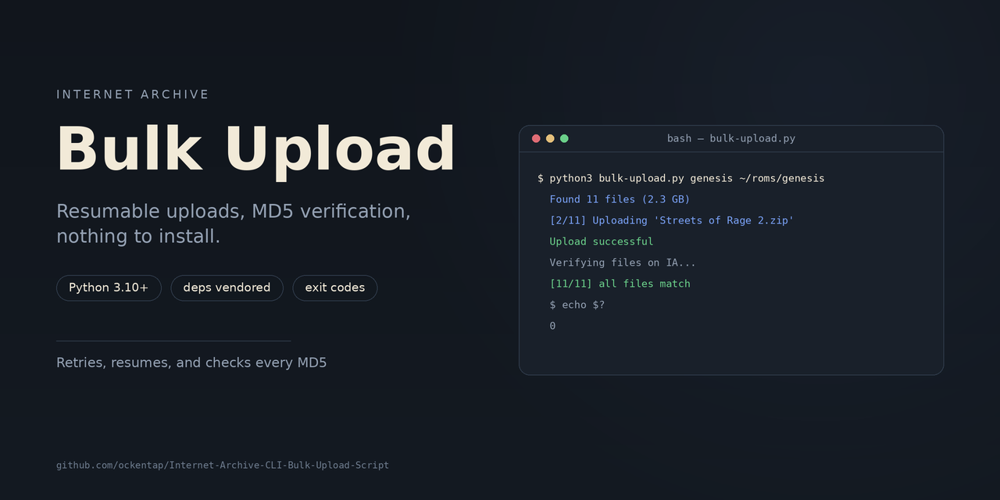
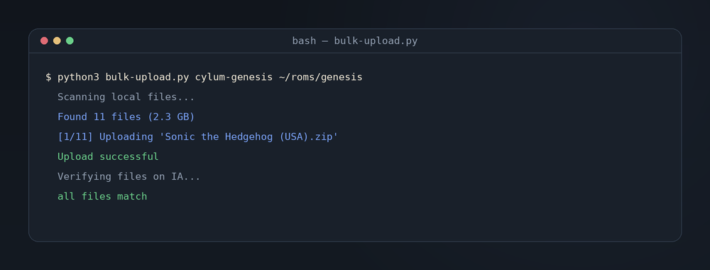

# Internet Archive CLI Bulk-Upload Script



Interactive bulk uploader for archive.org: pick a directory, the script uploads what is not on the item yet, then verifies every file by MD5.

## Requirements

- Python 3.10+
- archive.org credentials in `~/.config/internetarchive/ia.ini` (`ia configure`, once)

Dependencies are vendored in `vendor/` — nothing to install.

## Usage

```bash
python3 bulk-upload.py                       # interactive: pick identifier + directory
python3 bulk-upload.py my-item /path/files   # start from a given identifier/directory
python3 bulk-upload.py my-item /path --yes   # no prompts (cron, unattended)
python3 bulk-upload.py my-item /path --yes --workers 3   # 3 parallel uploads (1-5)
```



State lives next to the `ia` CLI config in `~/.config/internetarchive/`: `identifiers.json`, `metadata.json`, `upload_log.db`.

## Behaviour

- **Resumable** — re-running skips files already on the item.
- **Parallel workers** — `--workers N` (or the interactive prompt), 1–5, default 1.
  Gains are sublinear: measured ~1.6–2× aggregate throughput at 3 workers vs 1
  (2 MiB files), and 5 workers can be slower than 3. The biggest win is many small
  files, where per-file round-trip overhead overlaps. Default stays 1.
- **Verification** — size + MD5 per file, after archive.org finishes indexing (waits up to 15 min).
- **Metadata** — title, description, creator, date, subject, language.
- **Pre-configured launcher** — optionally writes `<identifier>.py`, which runs that identifier/directory with `--yes` (and the chosen worker count, if it is not 1).
- **Force upload** — interactive option; clears the local log and skips the IA sync so everything is really re-uploaded.
- **Exit codes** — non-zero when upload or verification fails.

## Notes

- Identifiers: 5–101 characters, `a-z A-Z 0-9 _ . -`, no spaces.
- Missing `vendor/`: `python3 -m pip install --target=vendor questionary internetarchive tqdm`

Provided as-is, no warranty.
